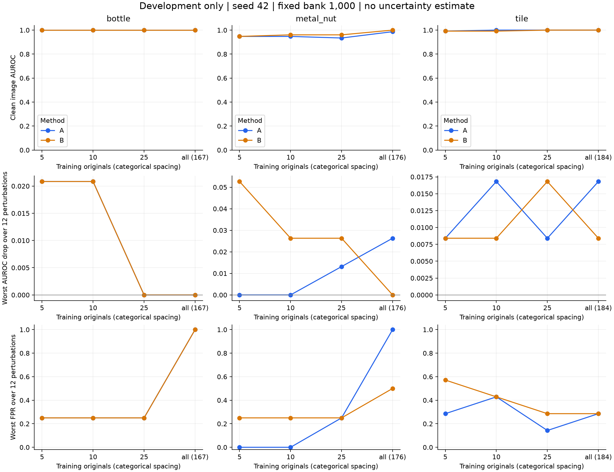
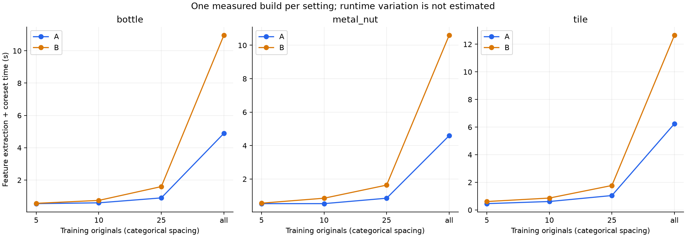

# 三类开发实验与资源估算

本轮为开发试验，seed=42，固定 1,000 个记忆库向量。未评估最终测试集。

主要观察、强扰动样例复核和后续决策见 [结果解读](findings.md)。

完成 **24 次建库、312 组条件指标、6,552 次开发图像评分**。这些评分来自 63 张独立开发原图，同一图片的多个扰动不视为独立样本。

## 数据与设置

| 类别 | 可用正常训练池 | 正常校准 | 开发正常 / 异常 | 保留最终测试 |
|---|---:|---:|---:|---:|
| bottle | 167 | 42 | 4 / 12 | 67 |
| metal_nut | 176 | 44 | 4 / 19 | 92 |
| tile | 184 | 46 | 7 / 17 | 93 |

A 使用原图；B 每张原图另加 3 个训练光照视图。训练数为 5/10/25/全量，同一类别的 A/B 样本一致，四档集合已验证嵌套。
测试条件为干净及亮度、对比度分别取 0.9/1.1/0.7/1.3/0.5/1.5，共 13 个条件。所有阈值只由各模型的干净正常校准分数确定。

## 开发结果

下表的最差退化是在 12 个光照条件中取最大值，条件可能因模型而异；并非对所有光照的平均结论。

| 类别 | 原图数 | 方法 | 干净图像 AUROC | 干净像素 AUROC | 干净误报 / 正常 | 干净检出 / 异常 | 最大图像 AUROC 下降 | 对应条件 |
|---|---:|---|---:|---:|---:|---:|---:|---|
| bottle | 5 | A | 1.0000 | 0.9887 | 1/4 | 12/12 | 0.0208 | brightness_1.5 |
| bottle | 5 | B | 1.0000 | 0.9884 | 1/4 | 12/12 | 0.0208 | contrast_1.3 |
| bottle | 10 | A | 1.0000 | 0.9886 | 1/4 | 12/12 | 0.0208 | contrast_1.3 |
| bottle | 10 | B | 1.0000 | 0.9886 | 1/4 | 12/12 | 0.0208 | brightness_1.5 |
| bottle | 25 | A | 1.0000 | 0.9886 | 0/4 | 12/12 | 0.0000 | brightness_0.9 |
| bottle | 25 | B | 1.0000 | 0.9887 | 0/4 | 12/12 | 0.0000 | brightness_0.9 |
| bottle | 167 | A | 1.0000 | 0.9883 | 0/4 | 12/12 | 0.0000 | brightness_0.9 |
| bottle | 167 | B | 1.0000 | 0.9887 | 0/4 | 12/12 | 0.0000 | brightness_0.9 |
| metal_nut | 5 | A | 0.9474 | 0.9751 | 0/4 | 14/19 | 0.0000 | brightness_0.9 |
| metal_nut | 5 | B | 0.9474 | 0.9757 | 0/4 | 14/19 | 0.0526 | brightness_1.3 |
| metal_nut | 10 | A | 0.9474 | 0.9785 | 0/4 | 15/19 | 0.0000 | brightness_0.9 |
| metal_nut | 10 | B | 0.9605 | 0.9786 | 0/4 | 14/19 | 0.0263 | brightness_1.3 |
| metal_nut | 25 | A | 0.9342 | 0.9779 | 0/4 | 16/19 | 0.0132 | contrast_1.5 |
| metal_nut | 25 | B | 0.9605 | 0.9796 | 0/4 | 16/19 | 0.0263 | brightness_1.3 |
| metal_nut | 176 | A | 0.9868 | 0.9785 | 0/4 | 18/19 | 0.0263 | brightness_1.5 |
| metal_nut | 176 | B | 1.0000 | 0.9773 | 0/4 | 19/19 | 0.0000 | brightness_0.9 |
| tile | 5 | A | 0.9916 | 0.9354 | 1/7 | 17/17 | 0.0084 | brightness_0.9 |
| tile | 5 | B | 0.9916 | 0.9353 | 1/7 | 17/17 | 0.0084 | brightness_0.7 |
| tile | 10 | A | 1.0000 | 0.9389 | 1/7 | 17/17 | 0.0168 | contrast_1.3 |
| tile | 10 | B | 0.9916 | 0.9387 | 0/7 | 16/17 | 0.0084 | brightness_1.1 |
| tile | 25 | A | 1.0000 | 0.9376 | 0/7 | 17/17 | 0.0084 | brightness_1.5 |
| tile | 25 | B | 1.0000 | 0.9393 | 0/7 | 17/17 | 0.0168 | contrast_0.5 |
| tile | 184 | A | 1.0000 | 0.9402 | 1/7 | 17/17 | 0.0168 | contrast_0.7 |
| tile | 184 | B | 1.0000 | 0.9407 | 0/7 | 17/17 | 0.0084 | brightness_0.5 |

## A/B 配对汇总

下表先在同一类别内对 12 个扰动条件等权平均，再对三个类别等权宏平均。它描述本轮所选条件，不代表真实光照发生频率。

| 原图预算 | 干净 B−A 图像 AUROC（宏平均） | 扰动 B−A 图像 AUROC（宏平均） | 扰动 B−A FPR（宏平均） | 扰动 B−A recall（宏平均） |
|---|---:|---:|---:|---:|
| 5 | +0.00000 | -0.00384 | +0.02679 | +0.00112 |
| 10 | +0.00158 | -0.00040 | -0.00099 | -0.01548 |
| 25 | +0.00877 | +0.00611 | +0.00000 | +0.01006 |
| all | +0.00439 | +0.00472 | -0.08730 | +0.01006 |

## 实测资源

24 个独立子进程累计耗时 **7.31 分钟**，产物 **1.48 GiB**（含原始异常图，未含数据集和环境）。

| 类别 | 方法（全量） | 候选向量 | 建库秒数 | 进程墙钟秒数 | CPU 峰值工作集 GiB | Torch 峰值分配 MiB | Torch 峰值预留 MiB | 推理中位 ms |
|---|---|---:|---:|---:|---:|---:|---:|---:|
| bottle | A | 130,928 | 4.89 | 17.56 | 1.48 | 108.9 | 130.0 | 4.77 |
| bottle | B | 523,712 | 10.96 | 23.53 | 3.72 | 400.3 | 418.0 | 6.25 |
| metal_nut | A | 137,984 | 4.59 | 19.46 | 1.51 | 115.0 | 136.0 | 4.58 |
| metal_nut | B | 551,936 | 10.59 | 25.55 | 3.88 | 420.8 | 442.0 | 4.78 |
| tile | A | 144,256 | 6.25 | 26.13 | 1.54 | 121.0 | 142.0 | 4.29 |
| tile | B | 577,024 | 12.65 | 31.55 | 4.01 | 439.4 | 460.0 | 4.86 |

所有运行保持记忆库 **1,000 × 384 × float32 = 1.465 MiB**。本轮各档实际运行均完成，支持当前 224 分辨率、batch=1 配置在这台 8 GB 显卡上继续使用该容量。
CPU 为每个独立进程至今峰值工作集；GPU 数字仅覆盖 PyTorch 分配器，不等于整卡占用，不包括驱动、桌面和其他应用。
推理计时为 3 次预热后，固定 3 张开发图各重复 10 次的中位数；包含 CPU→GPU、特征、近邻、异常图及回传，排除磁盘/PIL。建库每配置只测一次，尚无运行间误差估计。

## 三种子正式规模的成本预测（尚未执行）

按 A/B 72 次 + C 18 次，共 **90 次建库**；最终评估图片数由已保存清单计数，不读取最终图像或分数。
时间点估计 **73.0 分钟**；增加 50% 调度余量后约 **109.4 分钟**。输出文件估计约 **22.2 GiB**。
估算将评估整阶段耗时按最终/开发图像数量放大；建库、校准和启动沿用实测。C 按两个视图在 A 一个/B 四个视图之间线性插值。排序复杂度、磁盘缓存、温度和未来代码变化会造成偏差；50% 是规划余量，不是统计置信区间。
不含下载、人工复核、AU-PRO、另加方法、失败重跑及报告写作；协议尚未锁定，不能据此自动启动最终测试。

## 可靠性与下一步

- 本轮只有 seed=42，不计算跨种子标准差或显著性；小规模开发样本不足以确认 RQ1–RQ3。
- 正常开发图 bottle/metal_nut 各 4 张、tile 7 张，FPR 每错一张分别跳动 25%/25%/14.29%，必须结合原始计数解释。
- 完整保留所有 13 个条件与不利结果；重度扰动需结合接触表和裁剪比例审查，不能按最终得分删除条件。
- 对照平滑/加权仍沿用已核对的简化基线；本轮仅增加计时采集，不改变模型、抽样或评分算法。
- 下一步根据开发失败案例固定增强方案与压力测试说明，再进行三个种子的开发稳定性检查和 C 消融；正式评估需要先锁定协议。

## 文件

- `metrics.csv`：312 行类别/样本量/方法/条件指标。
- `paired_differences.csv`：156 行相同样本和条件的 B−A。
- `resources.csv`：24 组实测资源。
- `formal_cost_projection.csv` / `resource_estimate.json`：成本推算与假设。
- `clipping.csv`、`*_illumination.png`：开发扰动诊断，正常/异常掩码均按原图配对。
- `records/dev_matrix_v1/`：不可变计划、核心源码快照、配置和摘要。
- `outputs/dev_matrix_v1/`：原始逐图分数、异常图、模型、日志和恢复状态。
