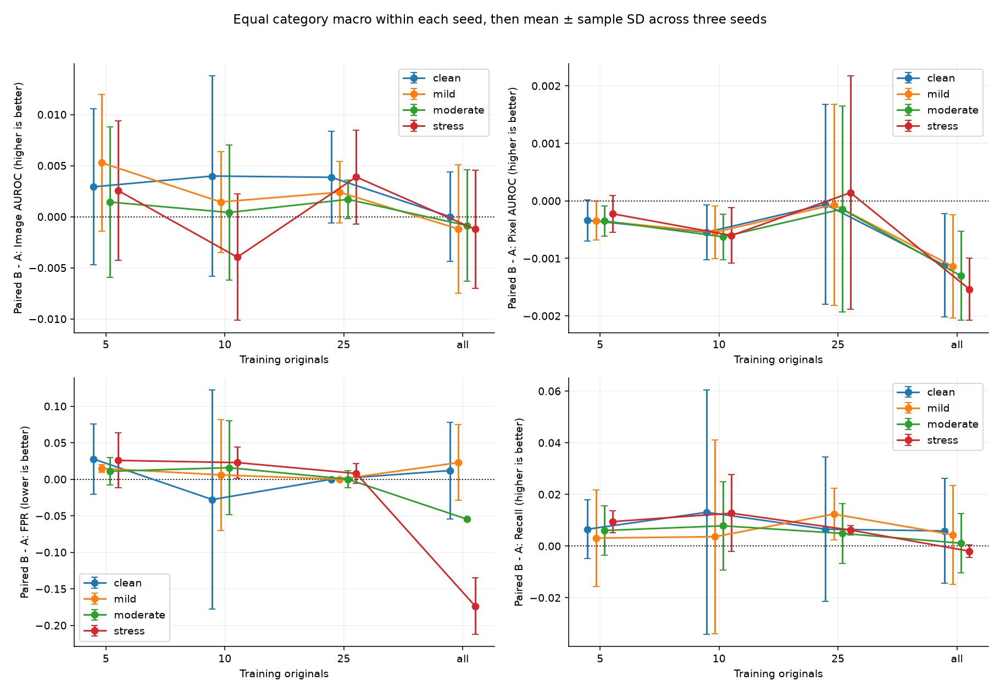
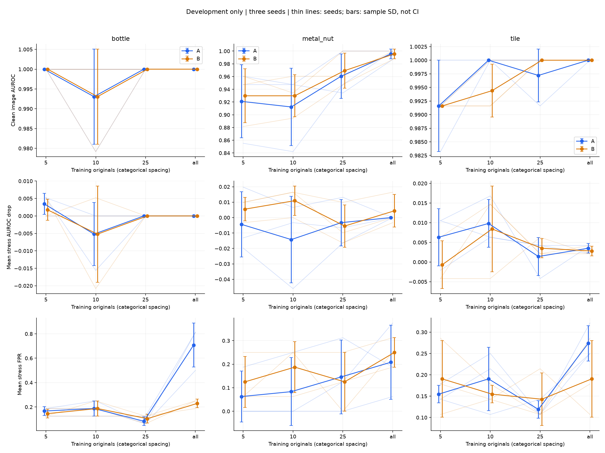
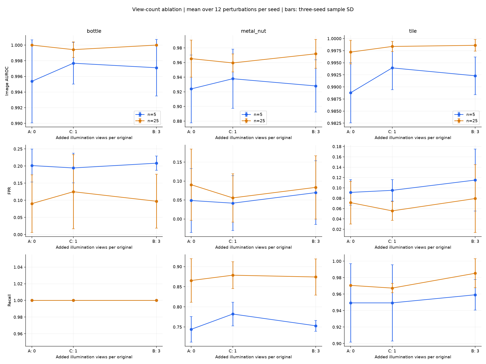

# 三种子开发稳定性与 C 消融

实验完成于 2026-10-06，汇总复核于 2026-10-07。工作目录：`D:\ChatGPT\111`。本报告使用开发集，最终测试未运行，正式协议尚未锁定。

本轮新增 **66 次建库**；合并已有 seed42 的 24 组，共 **90 个模型、1,170 行条件指标、24,570 条评分**。独立开发原图仍为 **63 张**。

## 设计与核验

- A/B：三类 × 5/10/25/全量 × 三种子（17、42、2026），共 72 组。C：三类 × 5/25 张 × 同三种子，共 18 组。
- 所有模型沿用已核对的轻量 PatchCore；骨干、权重、划分、224 输入、评分流程一致，记忆库固定 1,000 向量。
- 核对同种子 A/B/C 原图相同、样本预算嵌套、C 的增强视图与 B 的首个增强视图相同。全量组跨种子原图集合相同，顺序、增强和采样可不同。
- 重算所有干净校准阈值、严格大于判定、误报/检出计数、图像 AUROC 和退化量；图像 AUROC 采用独立两两比较。像素 AUROC 使用已验证流程的保存值，本轮不重新排序全部像素。
- 全部 13 个条件保留；0.5/1.5 为压力条件单独解释。训练增强范围仍为 [0.8,1.2]，每个模型的干净校准阈值固定用于所有条件。

## 统计口径

先计算同类别、同预算、同条件、同种子的 B−A、C−A 和 B−C。跨种子使用均值与样本标准差（ddof=1）。宏平均在每个种子内先等权平均三个类别，再跨三个种子计算标准差，不能将 3 类 × 3 种子当作 9 个独立重复。

轻/中/压力条件各包含亮度和对比度的四个条件；全部扰动平均包含 12 条件。条件等权只描述本实验，不代表实际光照出现概率。误差条是三个种子的样本标准差，不能解释为置信区间或显著性。

## A/B 配对结果

下表为三个类别、12 个扰动条件的宏平均配对差，先在每个种子内聚合。FPR 负值表示误报减少；AUROC 和召回正值表示改善。

| 预算 | 图像 AUROC B−A | 像素 AUROC B−A | FPR B−A | 召回 B−A | 各种子图像 AUROC 差（17 / 42 / 2026） |
|---|---:|---:|---:|---:|---|
| 5 | +0.0031 ± 0.0065 | -0.0003 ± 0.0003 | +0.0172 ± 0.0094 | +0.0062 ± 0.0055 | +0.00399 / -0.00384 / +0.00911 |
| 10 | -0.0007 ± 0.0058 | -0.0006 ± 0.0004 | +0.0149 ± 0.0534 | +0.0081 ± 0.0224 | -0.00662 / -0.00040 / +0.00491 |
| 25 | +0.0027 ± 0.0030 | -0.0000 ± 0.0018 | +0.0026 ± 0.0083 | +0.0078 ± 0.0037 | +0.00133 / +0.00611 / +0.00054 |
| all | -0.0011 ± 0.0053 | -0.0013 ± 0.0007 | -0.0685 ± 0.0231 | +0.0012 ± 0.0107 | -0.00243 / +0.00472 / -0.00558 |



## 类别差异与干净代价

表中各数值均为三种子均值 ± 样本标准差。压力条件平均不等于最差条件；各条件的原始 FP/正常数及 TP/异常数见 metrics.csv。

| 类别 | 预算 | 干净图像 AUROC B−A | 压力图像 AUROC B−A | 压力 FPR B−A | 压力召回 B−A |
|---|---|---:|---:|---:|---:|
| bottle | 5 | +0.0000 ± 0.0000 | +0.0017 ± 0.0030 | -0.0208 ± 0.0361 | +0.0000 ± 0.0000 |
| bottle | 10 | +0.0000 ± 0.0000 | +0.0000 ± 0.0052 | +0.0000 ± 0.0000 | +0.0000 ± 0.0000 |
| bottle | 25 | +0.0000 ± 0.0000 | +0.0000 ± 0.0000 | +0.0208 ± 0.0361 | +0.0000 ± 0.0000 |
| bottle | all | +0.0000 ± 0.0000 | +0.0000 ± 0.0000 | -0.4792 ± 0.2009 | +0.0000 ± 0.0000 |
| metal_nut | 5 | +0.0088 ± 0.0152 | -0.0011 ± 0.0190 | +0.0625 ± 0.0000 | +0.0088 ± 0.0274 |
| metal_nut | 10 | +0.0175 ± 0.0331 | -0.0077 ± 0.0148 | +0.1042 ± 0.1301 | +0.0088 ± 0.0380 |
| metal_nut | 25 | +0.0088 ± 0.0152 | +0.0110 ± 0.0162 | -0.0208 ± 0.0361 | +0.0088 ± 0.0274 |
| metal_nut | all | +0.0000 ± 0.0132 | -0.0044 ± 0.0155 | +0.0417 ± 0.2009 | +0.0088 ± 0.0076 |
| tile | 5 | +0.0000 ± 0.0084 | +0.0070 ± 0.0053 | +0.0357 ± 0.1071 | +0.0196 ± 0.0225 |
| tile | 10 | -0.0056 ± 0.0049 | -0.0042 ± 0.0056 | -0.0357 ± 0.0714 | +0.0294 ± 0.0389 |
| tile | 25 | +0.0028 ± 0.0049 | +0.0007 ± 0.0024 | +0.0238 ± 0.0412 | +0.0098 ± 0.0225 |
| tile | all | +0.0000 ± 0.0000 | +0.0007 ± 0.0024 | -0.0833 ± 0.0546 | -0.0147 ± 0.0000 |



## C 消融：一个与三个增强视图

仅在 5 和 25 张进行。C−A 检查增加一个视图；B−C 检查再增加两个视图。以下对三类、12 个扰动等权宏平均后汇总三个种子，不将视图数增加预设为单调改善。

| 预算 | 比较 | 图像 AUROC 差 | 像素 AUROC 差 | FPR 差 | 召回差 |
|---|---|---:|---:|---:|---:|
| 5 | C-A | +0.0071 ± 0.0037 | +0.0001 ± 0.0003 | -0.0033 ± 0.0094 | +0.0127 ± 0.0146 |
| 5 | B-C | -0.0040 ± 0.0030 | -0.0004 ± 0.0005 | +0.0205 ± 0.0070 | -0.0065 ± 0.0166 |
| 25 | C-A | -0.0018 ± 0.0073 | -0.0003 ± 0.0010 | -0.0053 ± 0.0259 | +0.0033 ± 0.0098 |
| 25 | B-C | +0.0044 ± 0.0045 | +0.0003 ± 0.0018 | +0.0079 ± 0.0341 | +0.0045 ± 0.0087 |



## 固定阈值案例的种子检查

以下是上一轮已指出的案例，按相同条件展示全部种子，不从新结果挑选最优种子。

| 类别 / 条件 | 方法 | 种子 | 误报 / 正常 | 检出 / 异常 | 图像 AUROC |
|---|---|---:|---:|---:|---:|
| bottle / brightness_0.5 | A | 17 | 4/4 | 12/12 | 1.0000 |
| bottle / brightness_0.5 | A | 42 | 4/4 | 12/12 | 1.0000 |
| bottle / brightness_0.5 | A | 2026 | 4/4 | 12/12 | 1.0000 |
| bottle / brightness_0.5 | B | 17 | 0/4 | 12/12 | 1.0000 |
| bottle / brightness_0.5 | B | 42 | 0/4 | 12/12 | 1.0000 |
| bottle / brightness_0.5 | B | 2026 | 0/4 | 12/12 | 1.0000 |
| bottle / contrast_1.5 | A | 17 | 4/4 | 12/12 | 1.0000 |
| bottle / contrast_1.5 | A | 42 | 4/4 | 12/12 | 1.0000 |
| bottle / contrast_1.5 | A | 2026 | 4/4 | 12/12 | 1.0000 |
| bottle / contrast_1.5 | B | 17 | 4/4 | 12/12 | 1.0000 |
| bottle / contrast_1.5 | B | 42 | 4/4 | 12/12 | 1.0000 |
| bottle / contrast_1.5 | B | 2026 | 3/4 | 12/12 | 1.0000 |
| metal_nut / brightness_1.5 | A | 17 | 0/4 | 19/19 | 1.0000 |
| metal_nut / brightness_1.5 | A | 42 | 4/4 | 19/19 | 0.9605 |
| metal_nut / brightness_1.5 | A | 2026 | 1/4 | 19/19 | 1.0000 |
| metal_nut / brightness_1.5 | B | 17 | 1/4 | 19/19 | 0.9737 |
| metal_nut / brightness_1.5 | B | 42 | 1/4 | 19/19 | 1.0000 |
| metal_nut / brightness_1.5 | B | 2026 | 3/4 | 19/19 | 1.0000 |
| tile / brightness_0.5 | A | 17 | 1/7 | 17/17 | 0.9916 |
| tile / brightness_0.5 | A | 42 | 2/7 | 17/17 | 0.9916 |
| tile / brightness_0.5 | A | 2026 | 2/7 | 17/17 | 0.9916 |
| tile / brightness_0.5 | B | 17 | 2/7 | 17/17 | 0.9916 |
| tile / brightness_0.5 | B | 42 | 1/7 | 16/17 | 0.9916 |
| tile / brightness_0.5 | B | 2026 | 1/7 | 17/17 | 0.9916 |

## 实测资源与更新估算

新增 66 组子进程累计 **31.22 分钟**，产物 **4.07 GiB**；全部 90 组累计 **38.53 分钟**，产物 **5.55 GiB**。时间不包含本轮汇总与人工检查。

90 组最大 CPU 峰值工作集 **4.02 GiB**，Torch 峰值分配 **439.4 MiB**、预留 **460.0 MiB**。Torch 数字不是整卡占用。

建库包含特征提取与采样；推理是每组预热后固定三图各十次的中位数（不含磁盘与 PIL）。各配置只执行一次，各种子也改变样本/增强/采样，所以种子间耗时变化不能当作相同配置的重复测速误差。

使用实际 C 运行成本重新估算 90 组正式规模：时间点估计 **109.8 分钟**，加 50% 规划余量约 **164.7 分钟**，产物约 **22.2 GiB**。仅按最终/开发图片数量放大评估阶段；未执行最终测试。不同日期、缓存、温度和磁盘状态会影响估算，不含 AU-PRO、失败重跑和人工分析。

## 限制与后续

- 正常开发图每类只有 4、4、7 张，误报率分别以 25%、25%、14.29% 跳变；必须结合原始计数和异常召回解释。
- 三个种子刻画当前训练抽样、增强和采样的变化，不涵盖数据划分不确定性；全量组并非三份不同的训练图集合。
- 同一开发集已用于诊断与方法开发，本轮结果不能替代独立最终评估，不自动构成统计显著性证据。
- 下一步保存正式协议：保留三类、三种子、四档 A/B、限定 C、全部光照条件和固定校准规则；明确压力条件与报告口径后再开放最终测试。

## 复跑与产物

```powershell
Set-Location D:\ChatGPT\111
.\.venv\Scripts\python.exe scripts/run_dev_matrix.py --matrix configs/dev_ab_extra_seeds_v1.json
.\.venv\Scripts\python.exe scripts/run_dev_matrix.py --matrix configs/dev_c_ablation_v1.json
.\.venv-audit\Scripts\python.exe scripts/summarize_dev_stability.py
```

- metrics.csv / resources.csv：1170 行条件指标与 90 组资源，保留种子及原始误报/检出计数。
- paired_by_seed.csv：936 行 B−A、C−A、B−C 配对差；*_seed_summary.csv：三种子均值与样本标准差。
- severity* / macro*：类别与严重程度汇总，并保留先聚合后的逐种子值供核查。
- overview.json / provenance.json：资源估计、核验口径、输入与分析脚本哈希。
- 原模型与逐图评分保存在 outputs/ 下三个矩阵目录；计划、配置和核心源码快照保存在 records/ 对应目录。

## 样本数量与退化的顺序检查

按 5→10→25→全量检查同类别、同种子、同方法、同光照条件的退化序列。退化不增符合“更多原图减少退化”的方向；全相同单独列出，不能算作支持。该表统计有依赖的序列，不是独立样本数，也不进行显著性检验。

| 方法 | 指标 | 全相同 | 退化不增 | 退化不减 | 非单调 |
|---|---|---:|---:|---:|---:|
| A | 干净 AUROC − 扰动 AUROC | 38 | 19 | 7 | 44 |
| A | 扰动 FPR − 干净 FPR | 52 | 8 | 30 | 18 |
| B | 干净 AUROC − 扰动 AUROC | 36 | 9 | 12 | 51 |
| B | 扰动 FPR − 干净 FPR | 46 | 10 | 21 | 31 |

原始四档数值见 rq2_monotonicity.csv；全量是实际训练池大小，四档没有被当作等距连续数量拟合斜率。

## C 建库成本实测

下表为特征提取加采样的秒数，三种子均值 ± 样本标准差；种子改变输入与采样，不能当作相同配置的重复测速。

| 类别 | 原图预算 | A（原图） | C（加 1 视图） | B（加 3 视图） |
|---|---|---:|---:|---:|
| bottle | 5 | 0.6983 ± 0.1742 | 0.9311 ± 0.0728 | 0.7042 ± 0.1397 |
| bottle | 25 | 1.3287 ± 0.3801 | 1.8978 ± 0.0954 | 2.0393 ± 0.3840 |
| metal_nut | 5 | 0.6071 ± 0.0681 | 0.6465 ± 0.0061 | 0.6835 ± 0.1152 |
| metal_nut | 25 | 1.2348 ± 0.3314 | 1.7090 ± 0.0457 | 2.1036 ± 0.4147 |
| tile | 5 | 0.7124 ± 0.2206 | 1.0352 ± 0.1105 | 0.9199 ± 0.2836 |
| tile | 25 | 1.6251 ± 0.5191 | 2.6650 ± 0.2070 | 2.3056 ± 0.4658 |
