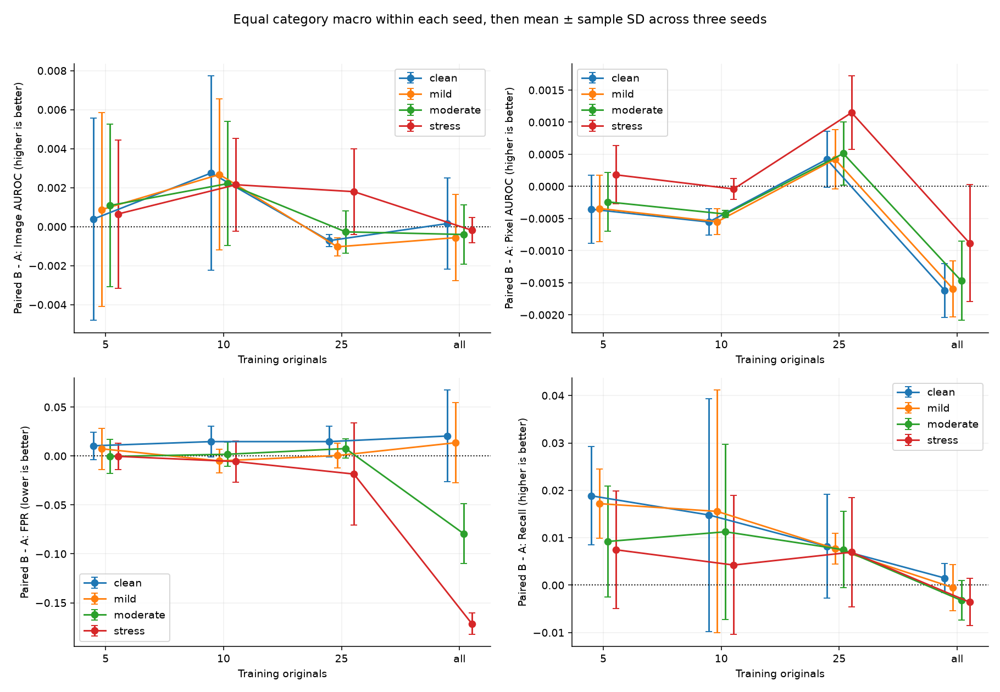
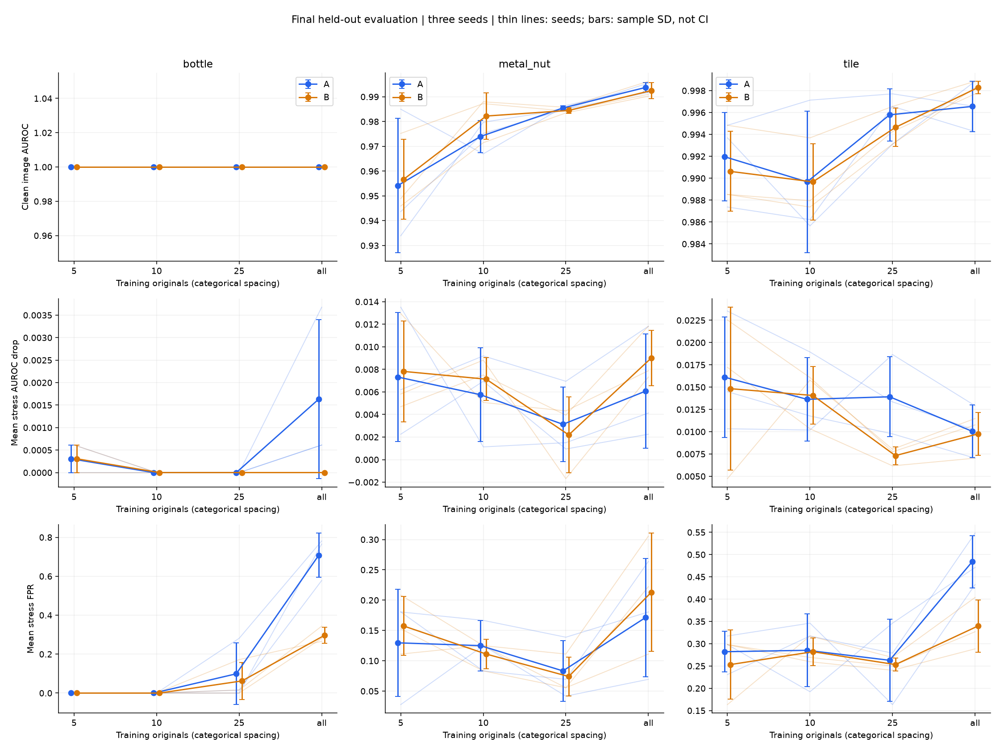
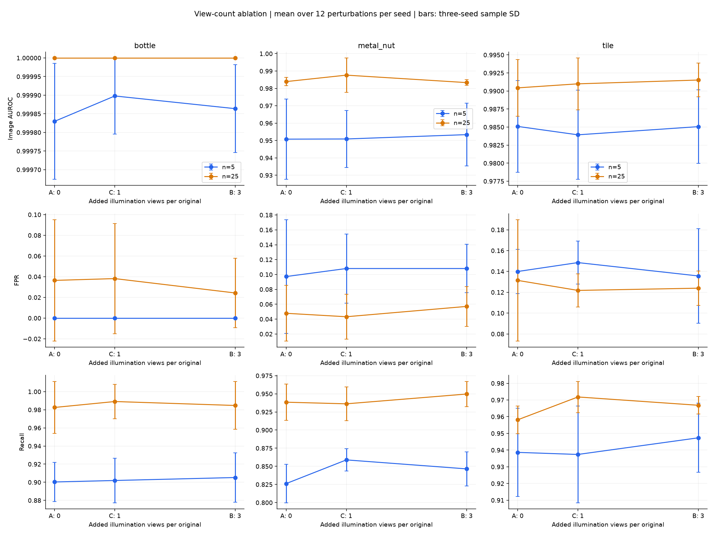

# 正式最终测试结果

协议：`formal_v1`；SHA-256：`58efbb9a2e54a4e276d062235f141f687a0aeaa84f26e48eb34cfe34b82a6885`。

共 **90 个已冻结模型、1,170 行条件指标、98,280 次评分**，来自 **252 张独立最终原图**。开发集和最终集分开，不是 MVTec 官方完整测试集成绩。

本次直接评估协议锁定前已验收的记忆库和干净校准阈值，没有重新建库或选取最优种子。三个种子给出均值与样本标准差（ddof=1），不自动构成统计显著性证据。

## 划分与计数

| 类别 | 正常最终图 | 异常最终图 | 正常校准图 | 训练池 |
|---|---:|---:|---:|---:|
| bottle | 16 | 51 | 42 | 167 |
| metal_nut | 18 | 74 | 44 | 176 |
| tile | 26 | 67 | 46 | 184 |

每个方法独立使用 5/10/25/全量正常训练原图；C 仅 5/25 张。开发异常标签曾用于方法开发，这一额外信息使用已披露；最终测试标签仅用于本轮冻结模型的指标计算。

## 干净条件与样本预算

| 类别 | 预算 | 方法 | 图像 AUROC | 像素 AUROC | FPR | 召回 |
|---|---|---|---:|---:|---:|---:|
| bottle | 5 | A | 1.0000 ± 0.0000 | 0.9799 ± 0.0002 | 0.0000 ± 0.0000 | 0.8889 ± 0.0226 |
| bottle | 5 | B | 1.0000 ± 0.0000 | 0.9799 ± 0.0002 | 0.0000 ± 0.0000 | 0.9085 ± 0.0408 |
| bottle | 5 | C | 1.0000 ± 0.0000 | 0.9799 ± 0.0002 | 0.0000 ± 0.0000 | 0.9085 ± 0.0408 |
| bottle | 10 | A | 1.0000 ± 0.0000 | 0.9801 ± 0.0000 | 0.0000 ± 0.0000 | 0.9346 ± 0.0113 |
| bottle | 10 | B | 1.0000 ± 0.0000 | 0.9800 ± 0.0003 | 0.0000 ± 0.0000 | 0.9281 ± 0.0226 |
| bottle | 25 | A | 1.0000 ± 0.0000 | 0.9800 ± 0.0003 | 0.0000 ± 0.0000 | 0.9804 ± 0.0340 |
| bottle | 25 | B | 1.0000 ± 0.0000 | 0.9799 ± 0.0002 | 0.0000 ± 0.0000 | 0.9869 ± 0.0226 |
| bottle | 25 | C | 1.0000 ± 0.0000 | 0.9800 ± 0.0005 | 0.0000 ± 0.0000 | 0.9869 ± 0.0226 |
| bottle | all | A | 1.0000 ± 0.0000 | 0.9794 ± 0.0005 | 0.0000 ± 0.0000 | 1.0000 ± 0.0000 |
| bottle | all | B | 1.0000 ± 0.0000 | 0.9790 ± 0.0002 | 0.0000 ± 0.0000 | 1.0000 ± 0.0000 |
| metal_nut | 5 | A | 0.9542 ± 0.0271 | 0.9649 ± 0.0049 | 0.0556 ± 0.0556 | 0.8243 ± 0.0270 |
| metal_nut | 5 | B | 0.9567 ± 0.0161 | 0.9644 ± 0.0053 | 0.0741 ± 0.0321 | 0.8514 ± 0.0135 |
| metal_nut | 5 | C | 0.9540 ± 0.0205 | 0.9651 ± 0.0044 | 0.0926 ± 0.0642 | 0.8604 ± 0.0078 |
| metal_nut | 10 | A | 0.9740 ± 0.0065 | 0.9730 ± 0.0040 | 0.0000 ± 0.0000 | 0.8784 ± 0.0234 |
| metal_nut | 10 | B | 0.9822 ± 0.0093 | 0.9729 ± 0.0041 | 0.0185 ± 0.0321 | 0.9144 ± 0.0340 |
| metal_nut | 25 | A | 0.9855 ± 0.0009 | 0.9775 ± 0.0002 | 0.0185 ± 0.0321 | 0.9324 ± 0.0234 |
| metal_nut | 25 | B | 0.9845 ± 0.0011 | 0.9778 ± 0.0007 | 0.0370 ± 0.0321 | 0.9505 ± 0.0206 |
| metal_nut | 25 | C | 0.9897 ± 0.0101 | 0.9778 ± 0.0004 | 0.0370 ± 0.0321 | 0.9414 ± 0.0156 |
| metal_nut | all | A | 0.9937 ± 0.0019 | 0.9779 ± 0.0010 | 0.0556 ± 0.0556 | 0.9775 ± 0.0078 |
| metal_nut | all | B | 0.9925 ± 0.0033 | 0.9766 ± 0.0009 | 0.1296 ± 0.0849 | 0.9820 ± 0.0078 |
| tile | 5 | A | 0.9920 ± 0.0040 | 0.9355 ± 0.0025 | 0.0513 ± 0.0222 | 0.9453 ± 0.0228 |
| tile | 5 | B | 0.9906 ± 0.0036 | 0.9350 ± 0.0013 | 0.0641 ± 0.0222 | 0.9552 ± 0.0259 |
| tile | 5 | C | 0.9908 ± 0.0049 | 0.9356 ± 0.0017 | 0.0513 ± 0.0222 | 0.9303 ± 0.0456 |
| tile | 10 | A | 0.9897 ± 0.0065 | 0.9370 ± 0.0011 | 0.0256 ± 0.0222 | 0.9204 ± 0.0524 |
| tile | 10 | B | 0.9897 ± 0.0035 | 0.9354 ± 0.0014 | 0.0513 ± 0.0444 | 0.9353 ± 0.0228 |
| tile | 25 | A | 0.9958 ± 0.0024 | 0.9380 ± 0.0014 | 0.0256 ± 0.0222 | 0.9652 ± 0.0086 |
| tile | 25 | B | 0.9946 ± 0.0018 | 0.9391 ± 0.0016 | 0.0513 ± 0.0222 | 0.9652 ± 0.0086 |
| tile | 25 | C | 0.9952 ± 0.0034 | 0.9397 ± 0.0010 | 0.0385 ± 0.0000 | 0.9751 ± 0.0086 |
| tile | all | A | 0.9966 ± 0.0023 | 0.9390 ± 0.0021 | 0.0769 ± 0.0385 | 0.9900 ± 0.0086 |
| tile | all | B | 0.9983 ± 0.0006 | 0.9357 ± 0.0012 | 0.0641 ± 0.0222 | 0.9900 ± 0.0086 |

## 方法配对差

先在同一类别、预算、条件和种子中相减；每个种子内等权平均类别与 12 个扰动，再对三个种子计算均值与标准差。条件等权不代表现实光照出现频率。FPR 负值表示误报减少，其余指标正值表示改善。

| 预算 | 对比 | 图像 AUROC 差 | 像素 AUROC 差 | FPR 差 | 召回差 |
|---|---|---:|---:|---:|---:|
| 5 | B-A | +0.0009 ± 0.0042 | -0.0001 ± 0.0005 | +0.0022 ± 0.0103 | +0.0113 ± 0.0093 |
| 5 | C-A | -0.0003 ± 0.0021 | +0.0002 ± 0.0003 | +0.0064 ± 0.0121 | +0.0110 ± 0.0141 |
| 5 | B-C | +0.0012 ± 0.0034 | -0.0003 ± 0.0002 | -0.0043 ± 0.0031 | +0.0003 ± 0.0107 |
| 10 | B-A | +0.0023 ± 0.0030 | -0.0003 ± 0.0000 | -0.0030 ± 0.0148 | +0.0104 ± 0.0194 |
| 25 | B-A | +0.0002 ± 0.0010 | +0.0007 ± 0.0005 | -0.0035 ± 0.0215 | +0.0074 ± 0.0072 |
| 25 | C-A | +0.0014 ± 0.0025 | +0.0009 ± 0.0004 | -0.0042 ± 0.0391 | +0.0060 ± 0.0076 |
| 25 | B-C | -0.0013 ± 0.0025 | -0.0002 ± 0.0003 | +0.0007 ± 0.0208 | +0.0014 ± 0.0055 |
| all | B-A | -0.0004 ± 0.0013 | -0.0013 ± 0.0007 | -0.0790 ± 0.0243 | -0.0024 ± 0.0039 |

## 压力条件与类别差异

0.5/1.5 在查看最终结果前已定义为压力条件。以下为四个压力条件的等权平均，不是最差条件；全部轻度、中度与单条件数据均保留。

| 类别 | 预算 | B−A 图像 AUROC | B−A 像素 AUROC | B−A FPR | B−A 召回 |
|---|---|---:|---:|---:|---:|
| bottle | 5 | +0.0000 ± 0.0000 | +0.0008 ± 0.0003 | +0.0000 ± 0.0000 | +0.0033 ± 0.0075 |
| bottle | 10 | +0.0000 ± 0.0000 | +0.0010 ± 0.0004 | +0.0000 ± 0.0000 | -0.0114 ± 0.0075 |
| bottle | 25 | +0.0000 ± 0.0000 | +0.0013 ± 0.0002 | -0.0365 ± 0.0631 | +0.0033 ± 0.0028 |
| bottle | all | +0.0016 ± 0.0018 | +0.0021 ± 0.0007 | -0.4115 ± 0.1542 | +0.0000 ± 0.0000 |
| metal_nut | 5 | +0.0020 ± 0.0092 | -0.0006 ± 0.0004 | +0.0278 ± 0.0556 | +0.0191 ± 0.0582 |
| metal_nut | 10 | +0.0069 ± 0.0061 | -0.0001 ± 0.0014 | -0.0139 ± 0.0241 | +0.0068 ± 0.0326 |
| metal_nut | 25 | -0.0001 ± 0.0019 | +0.0003 ± 0.0007 | -0.0093 ± 0.0212 | +0.0101 ± 0.0169 |
| metal_nut | all | -0.0042 ± 0.0026 | -0.0016 ± 0.0004 | +0.0417 ± 0.1690 | -0.0045 ± 0.0128 |
| tile | 5 | -0.0000 ± 0.0025 | +0.0003 ± 0.0012 | -0.0288 ± 0.0347 | +0.0000 ± 0.0245 |
| tile | 10 | -0.0004 ± 0.0039 | -0.0011 ± 0.0014 | -0.0032 ± 0.0818 | +0.0174 ± 0.0432 |
| tile | 25 | +0.0055 ± 0.0055 | +0.0018 ± 0.0012 | -0.0096 ± 0.0865 | +0.0075 ± 0.0163 |
| tile | all | +0.0020 ± 0.0016 | -0.0031 ± 0.0024 | -0.1442 ± 0.0000 | -0.0062 ± 0.0022 |

## 增强视图消融

A 为原图，C 增加一个视图，B 增加三个视图。三者原图配对、最终容量相同；视图不作为独立原图。完整 C−A 和 B−C 差值与逐种子值保存在表格中。

## 样本数量与退化

按 5→10→25→全量逐条件检查退化顺序。每方法共 108 条有依赖的类别/种子/扰动序列，不视为 108 个独立重复；全相同单列。

| 方法 | 指标 | 全相同 | 退化不增 | 退化不减 | 非单调 |
|---|---|---:|---:|---:|---:|
| A | image_auroc_drop | 28 | 11 | 14 | 55 |
| A | fpr_increase | 27 | 9 | 35 | 37 |
| B | image_auroc_drop | 32 | 6 | 15 | 55 |
| B | fpr_increase | 30 | 4 | 26 | 48 |

## 完整性与资源

90 组全部通过协议、冻结模型、样本清单、恒定阈值和输出 SHA-256 核验。独立两两比较复核全部图像 AUROC、误报/检出计数；预先指定的 6 组像素指标由原排序算法复核。

最终评估子进程累计 **46.94 分钟**，输出 **19.22 GiB**。复用模型，建库成本来自原已测量记录，不能把本次评估耗时当成重新训练加评估耗时。

最大 CPU 峰值工作集 **1.29 GiB**，Torch 最大分配 **51.8 MiB**、预留 **66.0 MiB**，不代表整卡占用。

推理耗时包括传输、特征、近邻、异常图与回传；排除磁盘/PIL。每模型预热三次，固定前三张最终图各测十次，另保留每次实际评分计时。最终入口缓存同一模型内的原始缩放图，像素 AUROC 用数学等价的负类排序与正类搜索计算，已在开发数据验证，不改变分数、图或指标定义。

## 边界与文件

- 不根据最终结果删除条件、换种子、重设阈值或调整增强。后续新增假设标为探索性。
- 三类、合成光照、自定义划分和少量正常最终图限制外推；标准差不是置信区间。AU-PRO 未纳入本轮核心指标。
- metrics.csv 保留每类/种子/条件的 FP、正常数、TP、异常数；paired_by_seed.csv 保留配对差。
- severity*、macro* 和 *_seed_summary.csv 提供严重程度、类别宏平均与三种子统计。
- resources.csv、overview.json、pixel_audit.json 和 provenance.json 保存资源、验收与可追溯记录。
- 协议：records/formal_v1/protocol.json；运行状态和全部分数/异常图：outputs/formal_v1/。
