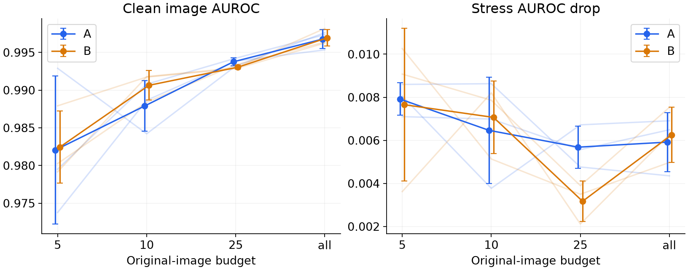
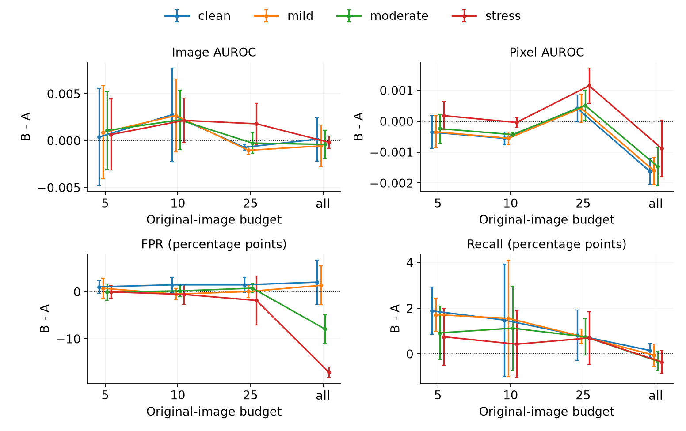
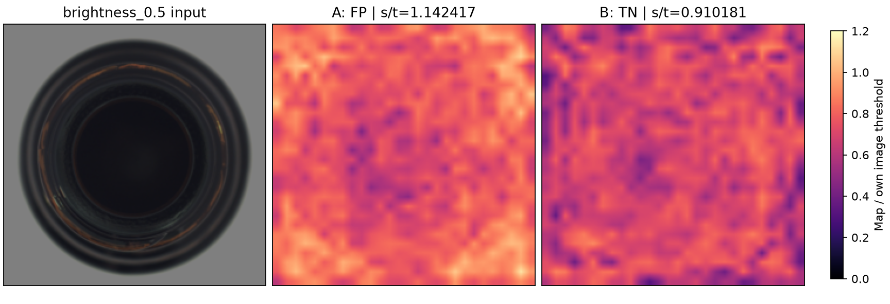
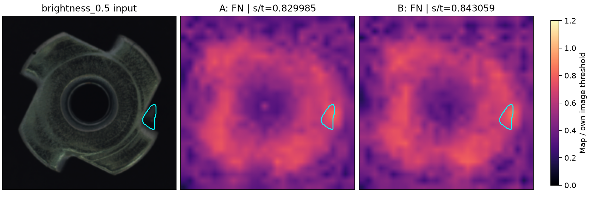
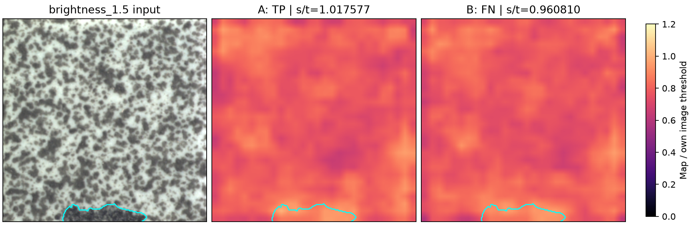

# Illumination Robustness with Limited Normal Training Images

<!-- PDF page 1 -->

A controlled study of a simplified PatchCore baseline
Technical report | 8 October 2026 | formal_v1 results, editorial revision 2

## Abstract

This project examines how normal-image budgets and synthetic illumination augmentation affect industrial anomaly detection at a fixed memory-bank capacity. A frozen ResNet18 feature extractor and a 1,000-vector memory bank are evaluated on bottle, metal_nut and tile. The locked matrix contains 90 models, three seeds and 13 conditions. Its 98,280 scoring events come from 252 independent held-out images, rather than 98,280 independent examples. All previously accepted development models and their clean-calibration thresholds are reused without selecting a winning seed.

Clean macro image AUROC increases with the original-image budget. However, illumination degradation is not universally monotonic: both main methods have 55 nonmonotone AUROC-degradation sequences out of 108 dependent sequences. Across 12 perturbations, three-view augmentation changes macro image AUROC by +0.00087, +0.00235, +0.00017 and -0.00038 at budgets 5, 10, 25 and all. At the full budget, mean FPR falls by 7.90 percentage points, while pixel AUROC and recall decrease slightly. A post-hoc audit retains every error and illustrates both corrected and introduced failures. These observations support conditional benefits, not universal robustness or statistical significance.

## 1. Research questions

| Question | Evidence |
|---|---|
| RQ1: Does a larger normal-image budget improve clean performance? | Compare 5, 10, 25 and all originals within each category and seed. |
| RQ2: Does illumination degradation depend on that budget? | Compare each perturbed image with its clean counterpart at a fixed threshold. |
| RQ3: Does augmentation help at fixed bank capacity? | Pair A/B; compare one-view C at budgets 5 and 25. |

## Scope and contribution

The contribution is a traceable empirical study and a checked lightweight implementation, rather than a new anomaly-detection algorithm. The deliverables include a frozen protocol, explicit data usage, paired multi-seed results, resource records, and reproducible error analysis. Negative results are retained. The split is custom; the numbers are not official full-test MVTec AD benchmark scores.

Reading guide: methods on page 2; data and protocol on page 3; RQ1-RQ2 on page 4; RQ3 on page 5; post-hoc failures on pages 6-7; limitations, reproducibility and references on page 8.

# 2. Method and implementation boundary

<!-- PDF page 2 -->

PatchCore uses a representative memory bank of nominal patch features for anomaly detection [1]. MVTec AD supplies industrial object and texture images with normal training images and annotated test defects [2,3]. This study adopts the memory-bank idea in a smaller, explicitly specified implementation. It does not attempt to match the original paper configuration or claim its benchmark performance.

| Component | Locked implementation |
|---|---|
| Input | RGB; direct bilinear resize to 224 x 224; ImageNet normalization |
| Backbone | Frozen ImageNet ResNet18; layer2 and layer3 |
| Patch features | 3 x 3 average pooling; bilinear feature alignment; 384 dimensions |
| Coreset | 64-dimensional Gaussian projection; greedy selection; fixed seed |
| Bank | 1,000 vectors; distinct candidate indices; float32 |
| Image score | Maximum raw Euclidean 1-nearest-neighbor patch distance |
| Anomaly map | Bilinear upsampling; no Gaussian smoothing |
| Threshold | Own clean-normal calibration 95th linear empirical quantile |

For image x with patch descriptors f_i(x) and bank M, the score is s(x) = max_i min_{m in M} ||f_i(x)-m||_2. A prediction is anomalous only when s(x) > t. The same t is used for every illumination condition of that model. The maximum of the interpolated pixel map need not equal the maximum of the original patch scores.

## 2.1 Original images, views and paired controls

A uses original normal images only. B adds three illumination views per original; C adds one. Each added view randomly chooses brightness or contrast and samples its factor uniformly from [0.8,1.2]. C uses the same first view as B. For each category and seed, original-image budgets are nested and methods share identical original images. All methods end with 1,000 memory vectors, so the bank capacity is controlled even though candidate counts differ.

## 2.2 Numerical implementation audit

Before final testing, the bottle/seed42/n5 A/B implementation was compared with actual Anomalib 2.2.0 code at a fixed commit. Features matched exactly; shared-bank k=1 image scores differed by at most 5.365e-6 in the audited cases. Original banks and scores were reconstructed exactly. The audit did not cover a full framework training pipeline or every category.

The simplified implementation intentionally differs in projection/coreset details, omits the default k=9 score reweighting, and uses a different map upsampling/smoothing path. These are disclosed algorithmic differences, not silently treated as identical framework behavior. The detailed local evidence is reports/baseline_audit.md.

# 3. Data, frozen protocol and measurement

<!-- PDF page 3 -->

| Category | Train pool | Calibration | Dev | Final normal | Final defect |
|---|---|---|---|---|---|
| bottle | 167 | 42 | 16 | 16 | 51 |
| metal_nut | 176 | 44 | 23 | 18 | 74 |
| tile | 184 | 46 | 24 | 26 | 67 |

The file-level manifest holds back about 20% of normal training images for calibration and about 20% of each test-defect stratum for development. Final evaluation contains 60 normal and 192 anomalous images. Development anomaly labels were used during method development; the research workflow is therefore not described as using only normal data. Training and threshold fitting themselves use normal images only.

## 3.1 Matrix and illumination

Seeds are 17, 42 and 2026. A and B cover four budgets in three categories (72 models); C covers budgets 5 and 25 (18 models). All 90 accepted models are reused. Full budget means 167, 176 and 184 originals for bottle, metal_nut and tile, respectively. No final-set tuning, seed selection or condition deletion is permitted.

Before ImageNet normalization, brightness is clip(b*x,0,1). Contrast is clip(c*(x-mu)+mu,0,1), where mu is the per-image, per-channel spatial mean. The 13 conditions are clean plus separate brightness and contrast factors 0.9, 1.1, 0.7, 1.3, 0.5 and 1.5. Factors 0.5/1.5 were designated as stress conditions before final evaluation. Masks are resized by nearest neighbor and are not geometrically changed by illumination.

## 3.2 Metrics and dependence

Core metrics are image AUROC, pooled resized-pixel AUROC, FPR and anomalous-image recall. Reported counts retain FP/normal and TP/anomalous denominators. Degradation is clean AUROC minus perturbed AUROC, or perturbed FPR minus clean FPR. For method effects, subtraction is within category, budget, seed and condition. Categories and conditions are equally weighted within each seed; the three-seed mean and sample SD (ddof=1) follow. SD is not a confidence interval. Repeated conditions, images and categories are not extra independent seeds. AU-PRO is outside this matrix.

## 3.3 Freeze and acceptance

Protocol formal_v1 was locked on 7 October 2026 at 15:36:50 (Asia/Shanghai), before the first final-image exposure at 15:37:35. Exact sources, weights, models, sample lists and thresholds were hashed. The optimized evaluator matched 819 development scores/maps exactly and 39 pixel metrics with zero difference before locking. Six preselected final pixel metrics also matched the original rank algorithm exactly. All final image metrics and confusion counts were independently recomputed.

The 95th empirical calibration quantile does not guarantee a future 5% FPR, particularly with only 42-46 calibration normals and 16-26 final normals per category.

# 4. Results: sample budget and degradation

<!-- PDF page 4 -->

| Original budget | A clean image AUROC | B clean image AUROC |
|---|---|---|
| 5 | 0.9821 +/- 0.0098 | 0.9824 +/- 0.0048 |
| 10 | 0.9879 +/- 0.0034 | 0.9906 +/- 0.0019 |
| 25 | 0.9938 +/- 0.0005 | 0.9930 +/- 0.0003 |
| all | 0.9968 +/- 0.0012 | 0.9969 +/- 0.0011 |

RQ1: the clean category macro increases with budget for A and B. This does not imply uniform improvement: bottle remains at 1.0 image AUROC, metal_nut improves in seed mean, and tile decreases from 5 to 10 originals. At full budget, B has clean macro FPR 0.0646 versus A 0.0442; B pixel AUROC is 0.9638 versus A 0.9654.

Figure 1. Equal-category macro for clean AUROC and mean stress degradation. Thin lines are seeds; bars are sample SD, not CI. The all budget differs by category. Per-category plots remain in the formal results appendix.

RQ2: each method has 108 dependent category/seed/perturbation sequences across budgets. For AUROC degradation, A has 28 tied, 11 nonincreasing, 14 nondecreasing and 55 nonmonotone sequences; B has 32, 6, 15 and 55. FPR-increase sequences are nonmonotone in 37 A and 48 B cases. The data do not support a universal rule that more originals always reduce illumination degradation.

# 5. Results: augmentation at fixed capacity

<!-- PDF page 5 -->

| Budget | Image AUROC | Pixel AUROC | FPR (pp) | Recall (pp) |
|---|---|---|---|---|
| 5 | +0.00087 +/- 0.00420 | -0.00013 +/- 0.00048 | +0.22 +/- 1.03 | +1.13 +/- 0.93 |
| 10 | +0.00235 +/- 0.00297 | -0.00034 +/- 0.00004 | -0.30 +/- 1.48 | +1.04 +/- 1.94 |
| 25 | +0.00017 +/- 0.00102 | +0.00070 +/- 0.00049 | -0.35 +/- 2.15 | +0.74 +/- 0.72 |
| all | -0.00038 +/- 0.00129 | -0.00132 +/- 0.00066 | -7.90 +/- 2.43 | -0.24 +/- 0.39 |

Paired B-A over all 12 perturbations and three equally weighted categories, then mean +/- sample SD over seeds. pp denotes percentage points. Negative FPR is beneficial; positive recall and AUROC are beneficial. The modest image-AUROC differences do not establish significance from three seeds.

Figure 2. Paired effects separated into clean, mild, moderate and stress conditions; bars are three-seed sample SD. The full-budget FPR benefit coexists with pixel-AUROC and recall costs.

## 5.1 One-view ablation and clean costs

For image AUROC over all perturbations, B-C is +0.00120 +/- 0.00338 at five originals and -0.00126 +/- 0.00246 at 25 originals. More views are not reliably better. Their mean ordering reverses relative to the development results; no method was reselected after observing this. Full-budget B reduces perturbed FPR by 7.90 pp but decreases pixel AUROC by 0.00132 and recall by 0.24 pp, while increasing clean FPR by 2.04 pp. RQ3 therefore has a conditional, multi-metric answer.

# 6. Post-hoc failure analysis: corrected and introduced errors

<!-- PDF page 6 -->

This analysis was designed after final results were visible. It reads accepted scores and saved maps only. All 98,280 events are retained, including 2,368 false positives and 4,667 false negatives. A/B contribute 39,312 paired comparisons. C is included in the error inventory but has fewer budgets, so raw cumulative counts must not rank it against A/B.

| Category / error | A errors | B errors | Both wrong | B rescued | B introduced |
|---|---|---|---|---|---|
| bottle / FP | 203 | 77 | 70 | 133 | 7 |
| bottle / FN | 371 | 369 | 345 | 26 | 24 |
| metal_nut / FP | 216 | 261 | 141 | 75 | 120 |
| metal_nut / FN | 1086 | 927 | 786 | 300 | 141 |
| tile / FP | 652 | 572 | 457 | 195 | 115 |
| tile / FN | 471 | 399 | 297 | 174 | 102 |

Dependent error events across all A/B budgets, seeds and conditions, including clean. These counts are not independent sample sizes or deployment rates. The identity B errors - A errors = introduced - rescued holds in every stratum. In metal_nut, fewer missed-defect events coexist with more false alarms.

Figure 3. Normal bottle good/000.png, full budget, seed17. Under brightness=0.5, A crosses its threshold (1.142417), while B remains below its own threshold (0.910181). The paired pattern occurs in all three seeds.

Maps are divided by their own image thresholds and share one display scale within each panel. They are not probabilities or pixel segmentation decisions. Eighteen cases cover six roles in each category. Selection prioritizes cross-seed recurrence, then stress conditions, specified budget order, frozen condition order, path and seed. All candidates and empty-role checks are retained; no role was empty.

# 7. Post-hoc failure analysis: response is not a decision

<!-- PDF page 7 -->

Figure 4. metal_nut bent/007.png, n=5, seed17. A/B already miss the defect under clean input. Darkening reduces the score/threshold ratios to 0.829985 and 0.843059. The resized mask occupies about 0.72% of the image.

The visible hotspot near the annotated edge does not guarantee a positive image decision. This example cannot isolate defect size, backbone sensitivity or calibration as the cause. A segmentation threshold was not defined, so visual correspondence is not a segmentation-success claim.

Figure 5. tile gray_stroke/012.png, n=25, seed17. At brightness=1.5, A detects the defect (1.017577) and B misses it (0.960810). Both already miss it under clean input.

Here introduced FN means a disadvantage of B relative to A at the same condition, not a clean-to-perturbed failure newly caused in B. The all_scores table separately records that within-model comparison. Other examples include corrected and introduced decisions close to one; six decimal places prevent a ratio such as 1.000327 from appearing exactly equal to the strict threshold.

# 8. Discussion, reproducibility and limitations

<!-- PDF page 8 -->

The strongest conclusion is the need to separate ranking quality, threshold decisions and spatial response. Full-budget bottle at contrast=1.5 reaches image AUROC 1.0 for A and B in every seed, yet A falsely flags 16/16 normals in every seed and B flags 16/16, 16/16 and 15/16. At brightness=0.5, B instead substantially reduces false alarms. A high AUROC alone does not establish usable fixed-threshold behavior.

Limitations include three categories, three seeds, small normal evaluation sets, synthetic brightness/contrast, direct square resizing, one backbone and a simplified coreset/scoring path. Development anomaly labels influenced the workflow. Post-hoc visual cases are explanatory, not causal or independently confirmed evidence. Clipping co-occurs with some errors, but zero-clipping cases also fail. New normalization, calibration or resolution hypotheses require a separately declared study and new independent evaluation data.

## 8.1 Resources and reproducibility

Accepted evaluation subprocesses total 46.94 minutes and 19.22 GiB of output. Peak CPU working set is 1.29 GiB; Torch peak allocated/reserved memory is 51.8/66.0 MiB, not whole-device usage. These costs exclude historical bank construction, interrupted attempts, extra audit work and waiting time. Job 40 was interrupted and repeated under the same protocol; 1,196 scores and 13 condition metrics matched exactly, excluding timing. Its first attempt remains archived in place.

Run from the repository root. Reproduction: docs/reproduction_v2.md. Frozen execution: docs/formal_execution.md. Protocol and acceptance: records/formal_v1/. Final tables: reports/formal_v1/. Rebuild this editorial revision with .venv-docs/Scripts/python.exe scripts/build_research_report.py. Setup and independent rerun instructions are in docs/reproduction_v2.md. No GPU inference is needed to rebuild this report. Exact input/output hashes accompany both analysis and report.

## 8.2 Contribution and tool disclosure

The human project owner directed the project stages and authorized protocol locking, final testing and this analysis. Code, experimental execution, numerical checks, figures and this report were produced with AI assistance in the shared workspace. This is a project-level contribution record, not evidence that the owner independently implemented or reviewed every component. Personal authorship and understanding claims require the owner's own verification before external submission.

## References and local evidence

[1] K. Roth et al. Towards Total Recall in Industrial Anomaly Detection. CVPR, 2022, pp. 14318-14328. <a href="https://openaccess.thecvf.com/content/CVPR2022/html/Roth_Towards_Total_Recall_in_Industrial_Anomaly_Detection_CVPR_2022_paper.html">CVF paper</a>.

[2] P. Bergmann et al. MVTec AD - A Comprehensive Real-World Dataset for Unsupervised Anomaly Detection. CVPR, 2019. <a href="https://openaccess.thecvf.com/content_CVPR_2019/html/Bergmann_MVTec_AD_--_A_Comprehensive_Real-World_Dataset_for_Unsupervised_Anomaly_CVPR_2019_paper.html">CVF paper</a>. [3] <a href="https://www.mvtec.com/research-teaching/datasets/mvtec-ad">MVTec AD official dataset</a>. Sources checked on 7 October 2026.

Local evidence: docs/formal_protocol_v1.md; reports/baseline_audit.md; reports/formal_v1/report.md; failure_analysis/report.md and interpretation.md. Locked protocol SHA-256: 58efbb9a2e54a4e276d062235f141f687a0aeaa84f26e48eb34cfe34b82a6885.
